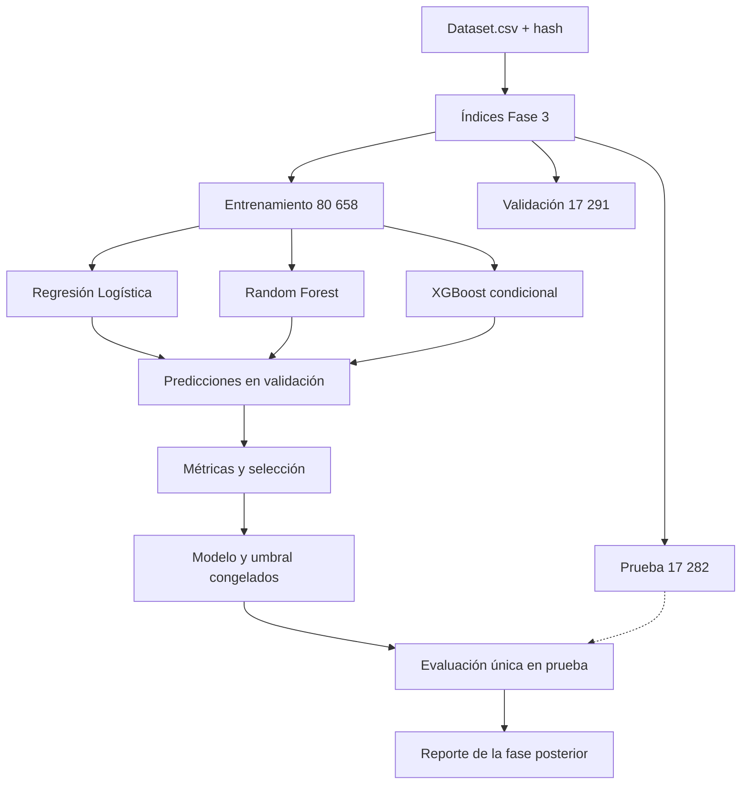

# Fase 4: diseño preliminar y selección de modelos

**Proyecto:** Análisis comparativo de algoritmos de aprendizaje automático para la detección de sitios web de phishing mediante características de las URL  
**Curso:** Inteligencia Artificial — Segunda unidad  
**Fecha:** 2026-10-25  
**Alcance:** diseño y justificación de modelos candidatos; **no se entrenó ni evaluó ningún modelo**.

---

## 1. Resumen de la fase

Se diseñaron tres candidatos para clasificación binaria tabular:

1. **Regresión Logística** como línea base sencilla e interpretable.
2. **Random Forest** como modelo de árboles con interacciones y no linealidad.
3. **XGBoost** como boosting de gradiente regularizado, **condicionado** a la disponibilidad y aprobación de la dependencia.

El diseño reutiliza la partición agrupada por dominio de la Fase 3, mantiene el conjunto de prueba reservado y define un protocolo para que la selección se haga solo con entrenamiento y validación. No se generaron predicciones, métricas ni resultados de rendimiento.

| Decisión | Resultado |
|---|---|
| Problema | Clasificación binaria: `0 = benigno`, `1 = phishing` |
| Predictores | 21 variables numéricas |
| Partición | Agrupada por `dom_normalizado`, 70/15/15, semilla `20261025` |
| Candidatos | Regresión Logística, Random Forest, XGBoost condicional |
| Métrica principal prevista | PR-AUC y recall de la clase 1 |
| Conjunto de prueba | Reservado para una evaluación final única |
| Modelos entrenados | Ninguno |
| Dependencias instaladas en esta fase | Ninguna |

---

## 2. Problema y datos de entrada

### 2.1 Formulación

Sea \(X\) la matriz de 21 características numéricas y \(y \in \{0, 1\}\) la etiqueta. El objetivo es estimar una probabilidad \(\hat{p}(y=1 \mid X)\) y, a partir de un umbral, asignar la clase phishing o benigno.

El problema presenta:

- desbalance aproximado de 6:1;
- variables discretas con muchos ceros y variables continuas con colas largas;
- relaciones potencialmente no lineales e interacciones entre características;
- dominios con etiquetas contradictorias;
- concentración de dominios grandes en validación y prueba;
- posibilidad de que `is_https` refleje un artefacto de recolección.

### 2.2 Datos y partición fija

Se usará el conjunto depurado de la Fase 3: 115 231 filas, de las cuales 98 641 son clase 0 y 16 590 son clase 1. La partición principal es:

| Partición | Filas | Clase 0 | Clase 1 | Tasa clase 1 | Uso previsto |
|---|---:|---:|---:|---:|---|
| Entrenamiento | 80 658 | 69 044 | 11 614 | 14,399 % | Ajustar pipelines y, si se autoriza, hiperparámetros. |
| Validación | 17 291 | 14 808 | 2 483 | 14,360 % | Comparar candidatos, elegir umbral y sensibilidad. |
| Prueba | 17 282 | 14 789 | 2 493 | 14,425 % | Evaluación final única del modelo y umbral congelados. |

Los índices están en `results/tables/20_particion_agrupada_indices.csv`. No se debe crear una nueva partición principal ni usar la partición aleatoria de comparación para seleccionar el modelo. `GroupKFold` solo se considera como análisis de sensibilidad si se autoriza, sin reemplazar la partición de referencia.

**Control de integridad:** `Dataset.csv` conserva el SHA-256 `d68b3cd0648dcf9c775347416ad1a8995e8a025921fbe3871ca6158d4db3c3a1`. La partición agrupada no comparte filas, URL ni dominios entre entrenamiento, validación y prueba.

### 2.3 Predictores

Se mantienen los 21 predictores numéricos definidos en la Fase 3:

`url_len`, `dom_len`, `tld_len`, `subdom_cnt`, `letter_cnt`, `digit_cnt`, `special_cnt`, `eq_cnt`, `qm_cnt`, `amp_cnt`, `dot_cnt`, `dash_cnt`, `under_cnt`, `letter_ratio`, `digit_ratio`, `spec_ratio`, `is_https`, `slash_cnt`, `entropy`, `path_len`, `query_len`.

No se usan como predictores `url`, `dom`, `dom_normalizado`, `tld` ni `is_ip`. `dom_normalizado` solo identifica el grupo de partición.

---

## 3. Criterios de diseño

Los candidatos se eligieron por los siguientes criterios:

1. **Adecuación a datos tabulares:** los tres algoritmos son apropiados para variables numéricas y tamaños de muestra moderados.
2. **Cobertura de complejidad:** una línea base lineal, un ensamble de árboles y un boosting de gradiente permiten comparar supuestos y capacidades distintas.
3. **Interpretabilidad:** la Regresión Logística ofrece coeficientes; Random Forest y XGBoost ofrecen importancia de variables, que debe interpretarse con cautela.
4. **Costo computacional:** se usarán configuraciones iniciales moderadas, sin búsquedas exhaustivas.
5. **Reproducibilidad:** semilla fija, versiones registradas y pipelines ajustados solo con entrenamiento.
6. **Control de fuga:** no se usarán identificadores ni información del dominio como predictores, y la prueba no participará en la selección.

No se incluye un árbol de decisión individual porque Random Forest cubre el enfoque de árboles con menor varianza. No se incluye Extra Trees para acotar el alcance. HistGradientBoosting no se propone como candidato principal; solo podría considerarse como alternativa si XGBoost no está disponible y el estudiante lo aprueba.

---

## 4. Preprocesamiento común

### 4.1 Reglas generales

- No se aplicará imputación: los 21 predictores no tienen faltantes.
- No se eliminarán valores extremos: pueden corresponder a URL reales y forman parte del fenómeno.
- No se usará `dom` ni `url` para codificación, conteo o agrupación dentro del modelo.
- Cualquier transformación que use información de los datos se ajustará **solo con entrenamiento** y se aplicará después a validación y prueba.
- No se seleccionarán variables con base en validación ni prueba antes de definir el protocolo; si se evalúa selección, se hará dentro del entrenamiento y se documentará.
- No se aplicará remuestreo antes de la partición. El desbalance se tratará inicialmente con pesos de clase.
- No se aplicará SMOTE en el diseño inicial: combinar linealmente conteos y proporciones puede producir URL poco realistas. Si se evalúa más adelante, deberá hacerse solo dentro del entrenamiento y como análisis de sensibilidad.

### 4.2 Escalado

- **Regresión Logística:** requiere `StandardScaler`, ajustado únicamente con entrenamiento.
- **Random Forest:** no requiere escalado.
- **XGBoost:** no requiere escalado para el tipo de variables disponible.

### 4.3 Desbalance

La clase 1 representa aproximadamente el 14,4 % del conjunto. Se usarán:

- `class_weight="balanced"` en Regresión Logística;
- `class_weight="balanced_subsample"` en Random Forest;
- `scale_pos_weight` en XGBoost, calculado solo con la proporción de negativos y positivos del entrenamiento.

Estos pesos favorecen la detección de phishing, pero **alteran la calibración de las probabilidades**. Por ello, las probabilidades no se interpretarán como probabilidades calibradas y la comparación se apoyará en curvas precision-recall, PR-AUC y umbrales explícitos.

### 4.4 Redundancia entre predictores

`url_len`–`letter_cnt` (r = 0,972) y `eq_cnt`–`amp_cnt` (r = 0,928) son pares altamente correlacionados. En el diseño inicial se conservan todos los predictores para no eliminar información sin evidencia. Consecuencias previstas:

- en Regresión Logística, los coeficientes individuales pueden ser inestables, aunque el ajuste global puede mantenerse;
- en Random Forest y XGBoost, la importancia se reparte entre variables correlacionadas;
- ninguna importancia o coeficiente se interpretará como relación causal.

---

## 5. Modelos candidatos

### 5.1 Regresión Logística — línea base

**Justificación:** modelo lineal, rápido, reproducible e interpretable. Permite comprobar cuánto se puede separar con una frontera lineal y sirve como referencia para evaluar si los modelos más complejos aportan una mejora real.

**Ventajas:**

- bajo costo computacional;
- coeficientes interpretables en escala de log-odds;
- menos propenso a sobreajustar con 21 variables y 80 658 filas;
- útil como línea base metodológica.

**Limitaciones:**

- no captura interacciones ni no linealidades sin transformaciones adicionales;
- sensible a la escala, por lo que requiere estandarización;
- los coeficientes pueden verse afectados por la colinealidad;
- los pesos de clase modifican la calibración.

**Configuración inicial:**

```text
Pipeline:
  StandardScaler()
  LogisticRegression(
      penalty="l2",
      C=1.0,
      solver="lbfgs",
      max_iter=2000,
      class_weight="balanced",
      random_state=20261025
  )
```

No se agregarán términos polinómicos ni interacciones en la configuración inicial. Si se consideran, se definirán antes de mirar prueba y se ajustarán solo con entrenamiento.

### 5.2 Random Forest

**Justificación:** captura relaciones no lineales e interacciones, es robusto a la escala y permite obtener importancia de variables. Es un candidato estándar para datos tabulares y complementa la línea base lineal.

**Ventajas:**

- no requiere escalado;
- maneja interacciones y umbrales;
- menor varianza que un árbol individual;
- relativamente robusto a valores extremos;
- permite analizar importancia y errores por subgrupos.

**Limitaciones:**

- mayor costo de entrenamiento e inferencia que la Regresión Logística;
- la importancia puede dispersarse entre variables correlacionadas;
- no extrapola fuera del rango observado;
- los pesos de clase pueden afectar la calibración;
- la configuración inicial requiere ajuste posterior.

**Configuración inicial:**

```text
RandomForestClassifier(
    n_estimators=300,
    criterion="gini",
    max_depth=None,
    min_samples_leaf=2,
    max_features="sqrt",
    bootstrap=True,
    class_weight="balanced_subsample",
    n_jobs=-1,
    random_state=20261025
)
```

`n_estimators=300` es una configuración inicial razonable para estabilizar el ensamble sin una búsqueda amplia. No se usará `max_depth` ilimitado como garantía de mejor rendimiento; se controlará mediante `min_samples_leaf` y se evaluará solo con validación.

### 5.3 XGBoost — candidato condicional

**Justificación:** el boosting de gradiente puede capturar interacciones y relaciones no lineales con regularización. Es un candidato habitual en datos tabulares y permitiría comparar un ensamble secuencial con Random Forest.

**Ventajas:**

- buen desempeño potencial en datos tabulares;
- regularización explícita;
- manejo de interacciones y no linealidad;
- importancia y ganancia por variable;
- control del desbalance mediante `scale_pos_weight`.

**Limitaciones:**

- mayor cantidad de hiperparámetros y riesgo de sobreajuste;
- mayor costo de ajuste;
- requiere una dependencia adicional;
- los pesos de clase afectan la calibración;
- la interpretación de la importancia es menos directa que los coeficientes lineales.

**Configuración inicial propuesta:**

```text
XGBClassifier(
    n_estimators=300,
    learning_rate=0.05,
    max_depth=6,
    min_child_weight=1,
    subsample=0.8,
    colsample_bytree=0.8,
    reg_lambda=1.0,
    objective="binary:logistic",
    eval_metric="aucpr",
    tree_method="hist",
    scale_pos_weight=<negativos/positivos del entrenamiento>,
    n_jobs=-1,
    random_state=20261025
)
```

En el entrenamiento, la proporción es aproximadamente 5,945 negativos por cada positivo. El valor debe calcularse en el código a partir de `y_train`, no fijarse con validación ni prueba.

No se usará `early_stopping` en la configuración inicial, para no convertir la validación en parte del ajuste sin un protocolo explícito. Si se incorpora más adelante, el conjunto de evaluación debe ser validación y la prueba debe permanecer intacta.

**Condición de viabilidad:** XGBoost **no está instalado** en `.venv`. Esta fase no lo instala. Su uso en la fase posterior requiere aprobación explícita, instalación registrada y verificación de compatibilidad. Si no se autoriza o no es viable, no se reemplazará silenciosamente por otro modelo: se documentará la decisión y se solicitará una alternativa.

---

## 6. Comparación conceptual de candidatos

| Criterio | Regresión Logística | Random Forest | XGBoost |
|---|---|---|---|
| Tipo de frontera | Lineal | No lineal, por árboles | No lineal, boosting |
| Interacciones | No, salvo transformaciones | Sí | Sí |
| Escalado | Necesario | No | No |
| Interpretabilidad | Alta, coeficientes | Media, importancia | Media, importancia y ganancia |
| Costo computacional | Bajo | Medio | Medio-alto |
| Riesgo de sobreajuste | Bajo-medio | Medio | Medio-alto |
| Pesos de clase | Sí | Sí | Sí |
| Dependencia | `scikit-learn` | `scikit-learn` | `xgboost` |
| Estado actual | Diseñado | Diseñado | Diseñado, condicionado |

---

## 7. Métricas y protocolo de evaluación

### 7.1 Métricas previstas

Todas las métricas se calcularán en validación y, solo para el modelo final, una vez en prueba.

| Métrica | Uso previsto |
|---|---|
| Recall de clase 1 | Medir cuántos casos de phishing se detectan; es crítica porque un falso negativo puede exponer al usuario. |
| Precision de clase 1 | Medir cuántas alertas de phishing son correctas y estimar la carga de falsas alarmas. |
| F1 de clase 1 | Resumir el equilibrio entre precision y recall. |
| PR-AUC | Métrica principal para comparar modelos bajo desbalance; resume el rendimiento en distintos umbrales. |
| ROC-AUC | Métrica secundaria de separación global; puede ser optimista con desbalance. |
| Matriz de confusión | Mostrar falsos positivos y falsos negativos en cantidades absolutas. |
| Tasa de positivos predichos | Verificar que el umbral produce una carga operativa razonable. |

**Accuracy no se usará como criterio principal de selección.** Un modelo que prediga siempre “benigno” alcanzaría aproximadamente 85,6 % de accuracy y tendría recall cero para phishing.

### 7.2 Umbral

- Se reportarán las métricas con umbral **0,5** para comparar los candidatos en igualdad de condiciones.
- Se elegirá un umbral operativo **solo con validación**, maximizando F1 de la clase 1; también se revisará la curva precision-recall para discutir el costo de los falsos negativos.
- El modelo y el umbral se congelarán antes de evaluar prueba.
- No se ajustará el umbral con prueba ni se reportará el “mejor” resultado de múltiples umbrales evaluados en prueba.

### 7.3 Protocolo de selección

1. Verificar hash del dataset, índices de partición y conteos de filas y clases.
2. Reconstruir los conjuntos de entrenamiento, validación y prueba con los índices de la Fase 3.
3. Ajustar cada pipeline exclusivamente con entrenamiento.
4. Predecir validación y calcular todas las métricas previstas.
5. Comparar candidatos en validación con este orden:
   1. mayor PR-AUC;
   2. mayor recall de clase 1 en el umbral operativo;
   3. mayor F1 de clase 1;
   4. menor complejidad y costo computacional, si las diferencias son pequeñas.
6. Si se autoriza ajuste de hiperparámetros, hacerlo solo con entrenamiento y validación. La prueba no participa.
7. Congelar modelo, umbral y transformaciones.
8. Evaluar una sola vez en prueba y reportar el resultado, sin volver a seleccionar con base en esa evaluación.
9. Documentar semillas, versiones, tiempos y configuración.

### 7.4 Análisis de sensibilidad previsto

Los siguientes análisis son secundarios y **no deben usarse para elegir el modelo final con base en prueba**:

- comparar el modelo con y sin `is_https`, usando validación;
- analizar el efecto de dominios concentrados (`google.com` en validación, `weebly.com` en prueba);
- considerar `GroupKFold` agrupado por `dom_normalizado` como análisis de sensibilidad, solo si se autoriza la instalación de `scikit-learn`; no se ejecutó y no reemplaza la partición de referencia;
- revisar errores por dominio y por rango de longitud de URL;
- evaluar `is_ip` solo como sensibilidad, ya que no está en el conjunto primario;
- revisar calibración y elegir el umbral operativo en validación.

La prueba se usará una sola vez para el modelo y umbral seleccionados. Cualquier análisis adicional en prueba debe declararse como exploratorio y no como base de selección.

---

## 8. Diagrama lógico del flujo



**Lectura del diagrama:** entrenamiento ajusta los modelos; validación compara y elige; prueba solo recibe el modelo y el umbral ya congelados. La línea punteada indica que prueba no participa en las etapas de diseño ni selección.

---

## 9. Riesgos y limitaciones

1. **XGBoost no está instalado.** El candidato queda diseñado, pero no es ejecutable hasta que se apruebe e instale la dependencia.
2. **`scikit-learn` no está instalado.** La Regresión Logística y Random Forest tampoco pueden ejecutarse todavía; esta fase no instaló dependencias.
3. **Concentración de dominios.** `google.com` representa 8,39 % de las filas y **57,95 % de los positivos** de validación; `weebly.com`, 14,21 % de las filas y **98,03 % de los positivos** de prueba. Las métricas globales pueden estar dominadas por esos dominios; no deben interpretarse como generalización poblacional.
4. **`is_https` posible artefacto.** La diferencia entre clases (35,09 % vs. 91,43 %) puede reflejar el proceso de recolección. Se evaluará con y sin la variable en validación.
5. **Etiquetas contradictorias.** Los 24 dominios con ambas clases se conservan; parte del error puede ser ruido de etiqueta o phishing alojado en servicios legítimos.
6. **Redundancia.** `url_len`–`letter_cnt` y `eq_cnt`–`amp_cnt` están altamente correlacionados; las importancias y coeficientes deben interpretarse con cautela.
7. **Desbalance.** La clase 1 es minoritaria; accuracy no es suficiente y los pesos de clase pueden alterar la calibración.
8. **Validación no temporal.** No hay fecha de recolección por URL; la partición es aleatoria respecto de grupos, no temporal.
9. **Sin validación externa.** El diseño no demuestra generalización a datos de otras fuentes.
10. **Hiperparámetros iniciales.** Las configuraciones son puntos de partida, no resultados optimizados. Cualquier ajuste deberá documentarse y realizarse sin tocar prueba.
11. **Dependencia del etiquetado.** La calidad del modelo está limitada por la calidad de las etiquetas de la fuente.
12. **Sin resultados de rendimiento.** No se entrenó ni evaluó ningún modelo; no existen métricas que puedan presentarse como hallazgos.

---

## 10. Entregables y criterios de cierre

### 10.1 Entregables de esta fase

- Este documento: `results/model_design.md`.
- Actualización de `docs/continuidad/ESTADO_PROYECTO.md`, `docs/continuidad/BITACORA.md` y `docs/continuidad/PLAN_TRABAJO.md`.
- Registro de que no se instalaron dependencias ni se entrenaron modelos.

### 10.2 Criterios de aceptación

- Los tres candidatos están justificados para datos tabulares y para el problema.
- Las configuraciones iniciales son explícitas y reproducibles.
- El protocolo usa validación para seleccionar y reserva prueba para una evaluación final.
- Las métricas son adecuadas al desbalance.
- El posible artefacto de `is_https` y la concentración de dominios están documentados.
- No se presentan resultados de entrenamiento inexistentes.
- No se entrenó ni evaluó ningún modelo.
- El diseño es comprensible y defendible por el estudiante.

### 10.3 Cierre

La Fase 4 queda **ejecutada y pendiente de revisión**. No se debe iniciar el entrenamiento hasta que el estudiante apruebe este diseño y autorice la instalación de las dependencias necesarias. La Fase 5 solo debe redactar el informe con resultados verificables; si el docente exige entrenamiento, este corresponde a una fase posterior autorizada.

---

## 11. Referencia de la fuente de datos

Dam Minh, Linh; Tran Cong, Hung (2026). *URL-Phish: A Feature-Engineered Dataset for Phishing Detection* (Versión 2). Mendeley Data. DOI: `10.17632/65z9twcx3r.2`. Licencia CC BY 4.0. https://data.mendeley.com/datasets/65z9twcx3r/2
